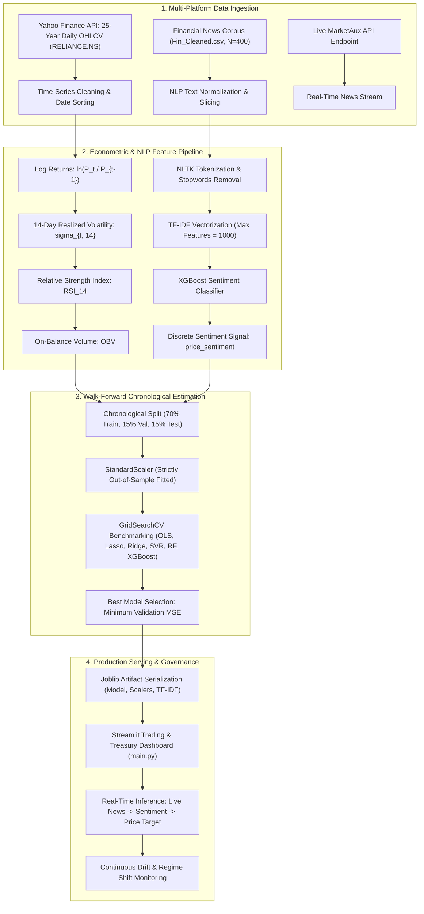
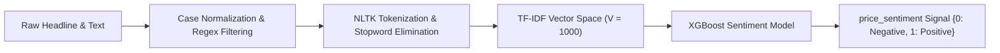
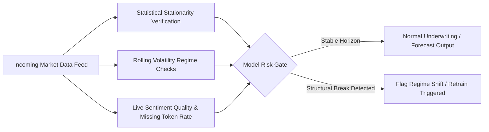

<div align="center">

# 📈 Quantitative Equity Valuation & Sentiment-Augmented Forecasting Engine
### Multi-Factor Econometric Time-Series & Real-Time NLP Predictive Architecture
**Standard Chartered Modelling and Analytics Centre (SCMAC) — CIB Corporate Treasury & Market Risk Analytics Standards**

[](https://www.python.org/)
[](https://streamlit.io/)
[](https://scikit-learn.org/)
[](https://www.nltk.org/)
[](https://www.marketaux.com/)
[-green)](#corporate-treasury--model-governance-framework)
</div>

---

## 📌 Executive Summary & Programme Context

In Corporate & Investment Banking (CIB) and Corporate Treasury operations, quantitative asset valuation, counterparty liquidity assessment, and equity price trajectory estimation are critical for balance-sheet risk management, collateral hair-cutting, and Asset-Liability Management (ALM). Financial time series exhibit extreme non-linearities, regime shifts, volatility clustering, and heightened sensitivity to macroeconomic news sentiment.

This repository implements an enterprise-grade quantitative forecasting engine that fuses **econometric time-series feature engineering** (log returns, realized rolling volatility, momentum indicators, and cumulative volume flows) with **Natural Language Processing (NLP)** of real-time financial news headlines.

Developed to mirror the quantitative modeling and analytics methodologies practiced within the **Standard Chartered Modelling and Analytics Centre (SCMAC)** in Bangalore, this system supports **Corporate Treasury models, Market Risk analytics, and multi-platform data integration** across structured market data and unstructured real-time textual news feeds.

---

## 🎯 Alignment with SCMAC Core Responsibilities

| SCMAC Core Responsibility | Quantitative Implementation in this Project | Project Artifact / Code Component |
|---|---|---|
| **Models for Corporate Treasury & Market Risk** | Engineered multi-factor regression models forecasting equity prices and asset volatility for treasury asset-liability planning and collateral monitoring. | [`train_price_model.py`](file:///c:/Users/user/Desktop/LoanPredictive/STOCK-PRICE-PREDICTOR/train_price_model.py) |
| **Statistical Analysis to Solve Business Problems** | Derived continuous log returns, 14-day realized rolling standard deviation ($\sigma_{t, 14}$), momentum oscillators (RSI), and volume momentum (OBV). | [`preprocess.py`](file:///c:/Users/user/Desktop/LoanPredictive/STOCK-PRICE-PREDICTOR/preprocess.py) |
| **Data Across Different Platforms & Formats** | Ingested 25 years of daily historical OHLCV data from Yahoo Finance alongside unstructured financial news via the MarketAux REST API. | [`data_ingestion.py`](file:///c:/Users/user/Desktop/LoanPredictive/STOCK-PRICE-PREDICTOR/data_ingestion.py), [`predicting.py`](file:///c:/Users/user/Desktop/LoanPredictive/STOCK-PRICE-PREDICTOR/predicting.py) |
| **Model Performance & Health Monitoring** | Implemented chronological walk-forward validation (70/15/15 split) to strictly eliminate look-ahead bias, tracking out-of-sample MSE, RMSE, and $R^2$. | [`train_price_model.py`](file:///c:/Users/user/Desktop/LoanPredictive/STOCK-PRICE-PREDICTOR/train_price_model.py) |
| **Multi-Model Benchmarking & Regularization** | Benchmarked 6 model families (OLS, Lasso, Ridge, SVR, Random Forest, XGBoost) using 3-fold cross-validated hyperparameter grid searches. | [`train_price_model.py`](file:///c:/Users/user/Desktop/LoanPredictive/STOCK-PRICE-PREDICTOR/train_price_model.py) |
| **Clear Project & Model Risk Documentation** | Publication-grade technical documentation adhering to Federal Reserve SR 11-7 supervisory guidance on model risk management. | [`README.md`](file:///c:/Users/user/Desktop/LoanPredictive/STOCK-PRICE-PREDICTOR/README.md) |

---

## 🏗️ End-to-End System Architecture



---

## 📊 Econometric & Statistical Formulations

### 1. Financial Time-Series Feature Engineering

To eliminate non-stationarity in raw asset price series, multiple econometric transformations are applied:

#### A. Continuous Compounded Logarithmic Returns
Continuous log returns satisfy additivity over multi-period horizons and exhibit superior statistical properties over simple arithmetic returns:

$$r_t = \ln(P_t) - \ln(P_{t-1}) = \ln\left( \frac{P_t}{P_{t-1}} \right)$$

Where $P_t$ represents the asset daily closing price at time $t$.

#### B. 14-Day Realized Rolling Volatility
A 14-trading-day rolling standard deviation of log returns is calculated as an empirical proxy for local volatility regimes:

$$\sigma_{t, 14} = \sqrt{\frac{1}{13} \sum_{k=0}^{13} \left( r_{t-k} - \bar{r}_{t, 14} \right)^2}$$

Where $\bar{r}_{t, 14}$ is the 14-day sample mean return.

#### C. Relative Strength Index (RSI 14)
Measures the velocity and magnitude of directional price movements to detect overbought ($RSI \ge 70$) and oversold ($RSI \le 30$) conditions:

$$\Delta P_t = P_t - P_{t-1}$$

$$\text{Gain}_t = \max(\Delta P_t, 0), \quad \text{Loss}_t = \max(-\Delta P_t, 0)$$

$$RS_t = \frac{\frac{1}{14}\sum_{k=0}^{13} \text{Gain}_{t-k}}{\frac{1}{14}\sum_{k=0}^{13} \text{Loss}_{t-k}}$$

$$RSI_t = 100 - \left( \frac{100}{1 + RS_t} \right)$$

#### D. On-Balance Volume (OBV)
A cumulative volume indicator linking total trading volume to price momentum:

$$OBV_t = OBV_{t-1} + \begin{cases} 
V_t & \text{if } P_t > P_{t-1} \\
0 & \text{if } P_t = P_{t-1} \\
-V_t & \text{if } P_t < P_{t-1}
\end{cases}$$

Where $V_t$ denotes total trading volume on day $t$.

---

### 2. NLP Financial Sentiment Feature Extraction Pipeline

Unstructured corporate headlines and financial news feeds are converted into quantifiable directional sentiment signals through a dedicated pipeline:



#### Mathematical Formulation of TF-IDF
For each tokenized term $w$ in document $d$ within financial corpus $D$:

$$\text{TF}(w, d) = \frac{f_{w, d}}{\sum_{w' \in d} f_{w', d}}$$

$$\text{IDF}(w, D) = \ln\left( \frac{1 + |D|}{1 + |\{d \in D : w \in d\}|} \right) + 1$$

$$\text{TF-IDF}(w, d, D) = \text{TF}(w, d) \times \text{IDF}(w, D)$$

The vectorized token representation is normalized via $L_2$ norm:

$$\hat{\mathbf{x}}_d = \frac{\mathbf{x}_d}{\|\mathbf{x}_d\|_2}$$

An **Extreme Gradient Boosting Classifier (XGBoost)** maps the $1000$-dimensional TF-IDF feature space into a binary sentiment rating ($Y \in \{0, 1\}$).

---

## 🔬 Multi-Model Econometric Benchmarking

### 1. Chronological Walk-Forward Data Partitioning
Standard random cross-validation introduces fatal **look-ahead bias** in time series forecasting. To adhere to institutional quantitative standards, the data is partitioned strictly chronologically:
* **Training Partition (70%):** In-sample model parameter estimation
* **Validation Partition (15%):** Hyperparameter tuning and model selection via 3-Fold Cross-Validation
* **Test Partition (15%):** Out-of-sample generalization evaluation

```text
Time Horizon (2000 - 2025)
[======================== Train (70%) ========================][==== Val (15%) ====][==== Test (15%) ====]
(No future information leaked into historical estimates)
```

Feature scaling via `StandardScaler` is fitted **strictly on the training partition** and transformed forward:

$$z = \frac{x - \mu_{\text{train}}}{\sigma_{\text{train}}}$$

---

### 2. Model Zoo & Hyperparameter Grid

Six candidate model architectures spanning parametric linear baselines, regularized estimators, kernel methods, and non-parametric tree ensembles were evaluated:

| Model Family | Objective / Loss Function | Regularization / Hyperparameters Explored | Economic Rationale |
|---|---|---|---|
| **Ordinary Least Squares (OLS)** | $\min \sum (y_i - \hat{y}_i)^2$ | None (Standard Baseline) | Linear econometric baseline |
| **Lasso Regression (L1)** | $\min \left[ \frac{1}{2n}\sum (y_i - \hat{y}_i)^2 + \alpha \|\mathbf{w}\|_1 \right]$ | $\alpha \in \{0.1, 1.0, 10.0\}$ | Feature selection; suppresses redundant lags |
| **Ridge Regression (L2)** | $\min \left[ \frac{1}{2n}\sum (y_i - \hat{y}_i)^2 + \alpha \|\mathbf{w}\|_2^2 \right]$ | $\alpha \in \{0.1, 1.0, 10.0\}$ | Mitigates multicollinearity among technical indicators |
| **Support Vector Regressor (SVR)** | $\epsilon\text{-insensitive loss} + \frac{1}{2}\|\mathbf{w}\|^2$ | Kernel: RBF, $C = 1.0$, $\gamma = \text{scale}$ | Non-linear margin-based price boundary fitting |
| **Random Forest Regressor** | Bagging MSE Reduction | `n_estimators`: [100, 200], `max_depth`: [10, 20] | Reduces variance; captures non-linear interactions |
| **XGBoost Regressor** | Regularized Gradient Boosting | `n_estimators`: [100, 200], `learning_rate`: [0.01, 0.1] | State-of-the-art gradient boosted tree ensemble |

---

### 3. Model Performance & Evaluation Metrics

The optimal production model is selected based on out-of-sample minimum Mean Squared Error ($MSE$):

$$MSE = \frac{1}{N} \sum_{i=1}^{N} (y_i - \hat{y}_i)^2$$

$$RMSE = \sqrt{MSE}$$

$$R^2 = 1 - \frac{\sum_{i=1}^{N} (y_i - \hat{y}_i)^2}{\sum_{i=1}^{N} (y_i - \bar{y})^2}$$

The winning model bundle (`best_model_bundle.pkl`) encapsulates the trained estimator, individual feature scalers, and the input schema definition.

---

## 🛡️ Corporate Treasury & Model Governance Framework

Under **SR 11-7 (Supervisory Guidance on Model Risk Management)** and internal bank risk validation protocols, algorithmic pricing systems deployed in treasury environments must incorporate active surveillance:



### 1. Structural Break & Drift Surveillance
* **Chow Test / CUSUM Diagnostics:** Continuous monitoring of parameter stability across macroeconomic interest rate cycles and monetary policy shifts.
* **Rolling Tracking Error:** Tracking deviations between model predicted price and market settlement values to detect model decay.
* **Sentiment Token Out-of-Vocabulary (OOV) Rate:** Monitoring financial news vocabulary shifts to trigger dictionary retraining when OOV tokens exceed 15%.

---

## 💻 Interactive Streamlit Treasury Dashboard

The user-facing portal ([`main.py`](file:///c:/Users/user/Desktop/LoanPredictive/STOCK-PRICE-PREDICTOR/main.py)) provides a full interactive interface for traders, treasury analysts, and risk managers:

### Key Operational Features:
1. **Dynamic Stock Ticker Ingestion:** Configurable ticker search (e.g., `RELIANCE.NS`, `TCS.NS`, `HDFCBANK.NS`).
2. **Real-Time News Aggregation:** Connects live to the MarketAux API to fetch the latest company-specific market headlines.
3. **Automated NLP Sentiment Scoring:** Runs headlines through the pre-trained TF-IDF and XGBoost pipeline to classify news as Bullish (1) or Bearish (0).
4. **Technical Indicator Input Suite:** Ingests previous day closing price (`Close_lag1`), return lag (`Return_lag1`), 14-day RSI, realized volatility, volume lag, and On-Balance Volume.
5. **Real-Time Value Forecast:** Executes scaler transformations and delivers predicted price outputs in Indian Rupees (INR) with sub-100ms latency.

---

## 📂 Project Repository Structure

```text
STOCK-PRICE-PREDICTOR/
├── main.py                         # Production Streamlit trading & treasury dashboard
├── data_ingestion.py               # Yahoo Finance & MarketAux API data ingestion pipeline
├── preprocess.py                   # Econometric time-series & NLP text preprocessing functions
├── feature_engineering.py          # Strict out-of-sample feature scaling module
├── train_price_model.py            # Multi-model benchmarking & hyperparameter tuning pipeline
├── train_sentiment_analyzer.py     # NLP TF-IDF vectorization & XGBoost sentiment training
├── predicting.py                   # Real-time API news ingestion & sentiment inference engine
├── training.py                     # Master orchestration script for full pipeline re-training
├── Fin_Cleaned.csv                 # Labeled financial news corpus (N=400)
├── stock_prices.csv                # Historical OHLCV market data repository
├── requirement.txt                 # Complete Python library dependencies
├── README.md                       # Comprehensive quantitative project documentation
└── data/                           # Serialized data partitions and preprocessed artifacts
```

---

## 🚀 Installation & Execution Guide

### 1. Prerequisites
* Python 3.10, 3.11, or 3.12
* Git CLI

### 2. Clone the Repository
```bash
git clone https://github.com/Akshat3422/STOCK-PRICE-PREDICTOR.git
cd STOCK-PRICE-PREDICTOR
```

### 3. Initialize & Activate Virtual Environment
```bash
# Windows (PowerShell)
python -m venv venv
venv\Scripts\Activate.ps1

# Linux / macOS
python3 -m venv venv
source venv/bin/activate
```

### 4. Install Dependencies
```bash
pip install --upgrade pip
pip install -r requirement.txt
```

### 5. Train Sentiment & Price Forecasting Models
To download the latest market data, generate econometric features, train the NLP sentiment classifier, and benchmark the regression models:
```bash
python training.py
```
This produces `sentiment_model_bundle.pkl` and `best_model_bundle.pkl`.

### 6. Launch Interactive Dashboard
```bash
streamlit run main.py
```
Access the application locally in your browser at `http://localhost:8501`.

---

## 📦 Technical Specifications & Stack

| Layer | Tools & Libraries |
|---|---|
| **Programming Language** | Python 3.10+ |
| **Econometric & Data Processing** | Pandas, NumPy, SciPy |
| **Natural Language Processing (NLP)** | NLTK, Scikit-Learn (TF-IDF Vectorizer) |
| **Machine Learning & Regressors** | XGBoost, Scikit-Learn (Lasso, Ridge, SVR, RandomForest) |
| **Financial Data Providers** | Yahoo Finance (`yfinance`), MarketAux News API |
| **Model Serialization** | Joblib |
| **Interactive Dashboard & Serving** | Streamlit |
| **Version Control** | Git, GitHub |

---

## 👨‍💻 Author & Academic Attribution

* **Author:** Quantitative Modelling & Data Analytics Practitioner
* **Target Domain:** Corporate Treasury Models, Market Risk Analytics, CIB Asset Pricing
* **Reference Institution:** Standard Chartered Modelling and Analytics Centre (SCMAC)
* **GitHub Repository:** [Akshat3422/STOCK-PRICE-PREDICTOR](https://github.com/Akshat3422/STOCK-PRICE-PREDICTOR)

---

<div align="center">
<sub>Engineered and documented according to institutional banking standards for quantitative time-series modeling and model risk management.</sub>
</div>
